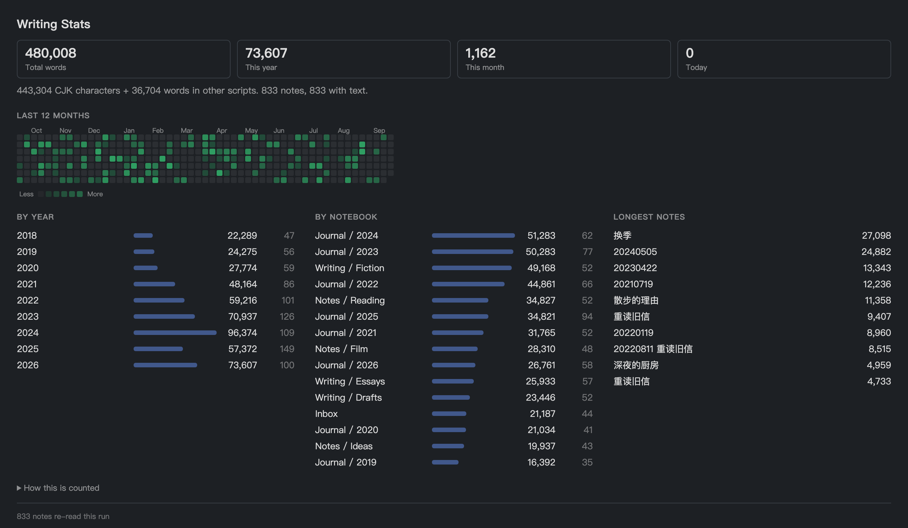

# Recall — a Joplin plugin

Rediscover your own notes, and see how much you've actually written.

- **Open a random note** — one click (or toolbar button) jumps you to a random
  note. Great for serendipitous review.
- **On This Day** — surfaces notes you created on *this calendar day in previous
  years*, the way photo apps show "memories". Joplin has no built-in equivalent.
- **Daily Recall digest** — generates a single note combining *On This Day* plus
  a handful of random notes, with clickable links. Optionally built automatically
  on startup.
- **Writing statistics** — the word count of your whole library: totals, a
  12-month heatmap, and breakdowns by year and by notebook.

## Writing statistics



<sub>Screenshot generated from a synthetic library (`node tools/demoData.js`), not
from anyone's real notes.</sub>

Every other Joplin word-count plugin counts the *current* note, and all of them
tokenise with `/\b\w+\b/`, where `\w` is ASCII-only. A 500-character Chinese
note reports **0 words**. Recall counts the whole library, and counts CJK
correctly:

| Text | `/\b\w+\b/` | Recall |
| --- | ---: | ---: |
| `今天下午去看了房子，中介说学区还不错。` | 0 | 17 |
| `读完这本书花了三天，里面讲的 survivorship bias 很有意思。` | 2 | 19 |
| `これはテストです` | 0 | 8 |
| `Today I went to see the apartment.` | 7 | 7 |

**How it counts.** Han characters, hiragana and katakana count per character —
the convention in Chinese and Japanese publishing. Every other script,
including Hangul and Cyrillic, counts per word. Before counting, markdown
syntax, URLs, attachment links, HTML tags and inline code are stripped, and
fenced code blocks are excluded entirely and reported separately. Full-width
punctuation is reported on its own line rather than folded into the total.
Recall's own generated notes are never counted.

**Performance.** Counts are cached per note and only recomputed when a note's
`updated_time` changes. On a 3,400-note library the first run reads every body
in ~70 paged API calls; later runs re-read nothing and only refresh the
metadata. The cache lives in a plugin setting (~220 KB at that size) and can be
rebuilt from the panel.

**Where it lives.** Open it from **Tools → Recall → Writing statistics**. It is
a dialog, not a panel, because this is a look-at-it-occasionally feature and a
panel would hold a column of the layout open for it permanently. From the
dialog you can copy the figures as Markdown or rebuild the cache.

## Usage

After installing, you get:

- A **die icon** in the note toolbar → open a random note.
- A **Tools → Recall** menu with every action.

## Settings

Settings → Recall:

| Setting | Default | What it does |
| --- | --- | --- |
| Random notes in Daily Recall | 3 | How many random notes the digest includes |
| Exclude completed to-dos | on | Skip finished to-dos when picking notes |
| Source notebook IDs | _(empty)_ | Comma-separated notebook IDs to review; empty = all notebooks |
| Include sub-notebooks | off | Include all descendants of the selected source notebooks |
| Target notebook ID | _(empty)_ | Where generated notes are stored; empty = default |
| Generate Daily Recall on startup | off | Auto-build the digest when Joplin starts |

The "On This Day" and "Daily Recall" notes are **upserted per day** —
re-running updates the same note instead of creating duplicates.

## Building from source

```bash
npm install
npm test            # counting assertions, including the CJK cases above
npm run dist        # produces publish/com.github.smieltalker.recall.jpl
```

Install the resulting `.jpl` via Joplin → Settings → Plugins → gear icon →
*Install from file*.

### Checking the counter against your own library

`tools/` holds two harnesses that run the real code against a real library with
the plugin API stubbed out (`tools/apiStub.ts`), so you can check both the
numbers and the layout without launching Joplin:

```bash
npm run harness

# numbers: totals, per-year and per-notebook breakdowns, cache behaviour
<dump> | node .harness-build/tools/statsHarness.js

# layout: renders the dialog to a standalone HTML file
# (a 5th argument of "light" or "dark" picks one theme; omit it for both)
<dump> | node .harness-build/tools/previewHarness.js out.html \
          src/webview/stats.css src/webview/stats.js
```

`<dump>` can be `node tools/demoData.js`, which emits a deterministic synthetic
library — that is how the screenshot above is produced, so no real notes are
involved:

```bash
node tools/demoData.js | node .harness-build/tools/previewHarness.js \
  docs/preview.html src/webview/stats.css src/webview/stats.js dark
```

To check it against your own library instead, pipe NDJSON on stdin out of a
read-only query against `database.sqlite` — one
`{"t":"n","v":{...note fields...}}` line per note and one
`{"t":"f","v":{...folder fields...}}` per notebook. Piping rather than dumping
to a file keeps your notes off disk.

## License

MIT

## Android test build (1.1.0)

This branch adds experimental Android support for Joplin 3.4 or newer. It has not
been released to npm or the official plugin directory. Physical-device testing
is still required before calling this stable. Desktop keeps its toolbar button,
Tools menu and statistics dialog.

1. Build with `npm run dist`, or use the supplied test `.jpl`.
2. On Android, open Configuration → Plugins → Advanced → Install from file and
   select `com.github.smieltalker.recall.jpl`. Restart Joplin if requested.
3. Sync your notes, then open Joplin's **plugin panels** button and select Recall.
4. Use Random note, On this day, Daily Recall, or Writing statistics.

The mobile statistics page reports scan progress. **Copy Markdown** copies the
figures; **Recount** clears the count cache and scans again. The first scan reads
all local note bodies, so a large library can take longer on a phone. Counts
reflect notes currently available on that device, not notes still waiting to sync.

**Generation and sync.** Automatic startup generation is disabled on mobile,
even if the desktop startup setting is on. Generate manually after syncing.
A sync that starts while Recall is running prevents a subsequent mobile summary
write, and repeated taps on one device cannot create overlapping summaries.
This is not a cross-device lock: independently generating on two offline devices
can still produce duplicate daily summaries after sync. Recall updates existing
daily summaries by exact title. With no target notebook ID, a new mobile summary
uses the current notebook, or the first available notebook if none is selected.

**Testing:** `npm test` checks counting rules; `npm run test:plugin` checks mobile
and desktop registration, generation, sync races, repeated taps, statistics,
cache reuse, errors, and retry behaviour using an in-memory API double.
These tests do not simulate Android's native WebView or prove device performance.
The offline preview and statistics harnesses remain available with `npm run harness`.

Date-based features now use Joplin's visible Created date (`user_created_time`),
falling back to internal `created_time` when unavailable. Imported or manually
backdated notes are therefore reviewed and grouped under their original dates.
This can change historical year/month/day breakdowns from version 1.0.1, without
changing the whole-library word total or modifying the source notes.


## Notebook sources (second Android test build, 1.1.1)

In **Settings → Recall**, set **Source notebook IDs (optional)** to one or more
notebook IDs separated by commas. On desktop, right-click a notebook and choose
**Copy notebook ID**. IDs identify the same synced notebook across devices;
configure Recall's source settings on each device where you use it.

- Leave source IDs empty to review the whole library (the existing default).
- Turn on **Include sub-notebooks** to include all descendant levels; default is off.
- These settings apply to Random note, On This Day, and both sections of Daily Recall.
- **Writing statistics always cover the whole library.**
- **Target notebook ID** still controls where newly generated summaries are saved.
  Existing summaries are updated in place, including when saved outside the source scope.
- Settings and notebook moves take effect on the next action without restarting.
- Malformed or unknown source IDs show an error; a source with no eligible notes
  shows a message. Neither falls back to all notebooks or overwrites a daily note
  with an empty-scope result. Sync first if a selected notebook is not yet available.
- Whitespace, duplicate IDs, uppercase hex IDs, and a trailing comma are accepted.

This second test build keeps all Android changes from 1.1.0. Upgrade by installing
its `.jpl` from file, then fully restart Joplin so the new settings appear. The first Android test build received positive feedback in
issue #1 from one tester using two devices (Joplin 3.7.8 on Android 16 and 17);
that report does not yet validate the new source filtering in 1.1.1.
